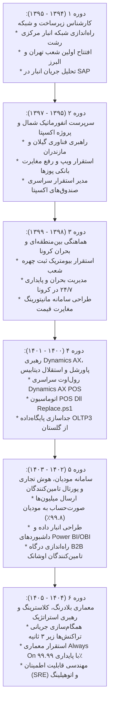

# مسیر دگرگونی و تکامل شغلی (Career Transformation 1394–1405)
## تحلیل ۱۱ سال تکامل نقش‌ها و شایستگی‌های مهدی باقری در اوشانک

### ۱. دگرگونی از تکنسین به معمار ارشد سیستم‌ها
مهدی باقری در ابتدا با دانش عملیاتی و مهندسی شبکه وارد شرکت شد، اما با هوشمندی، تحلیل فرآیندهای کسب‌وکار (مانند مستندسازی انبار SAP در ماه دوم اشتغال) را آغاز نمود و در ادامه با ارتقا به تسلط بر سیستم‌های ERP، دیتابیس‌های حجیم سازمانی و معماری داده، به مغز متفکر فناوری اطلاعات زنجیره هفت تبدیل شد.

### ۲. گسترش دامنه رهبری و ذی‌نفعان
دامنه تعاملات ایشان از تعامل با تکنسین‌های فنی و نصابان فروشگاه در سال ۱۳۹۴، به هدایت تیم‌های چندده‌نفره، مذاکره با معاونین هلدینگ (محمدرضا حاجی، علیرضا کیانی)، تعامل با سازمان امور مالیاتی کشور، مدیران عامل شرکت‌های پرداخت (SEP و PEP) و مدیران ارشد کارخانجات بزرگ FMCG ارتقا یافت.
