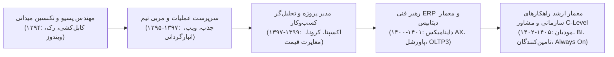

# تحلیل عمیق تکامل شایستگی‌ها و پویایی مسیر شغلی (Career Evolution Analysis)
## مطالعه موردی ۱۱ سال رشد چندبعدی مهدی باقری در مقیاس خرده‌فروشی ملی

### ۱. بلوغ از مداخله دستی به اتوماسیون سیستم‌ها
در سال ۱۳۹۴، مهدی باقری برای راه‌اندازی هر صندوق ساعت‌ها وقت صرف نصب دستی سیستم‌عامل و درایورها می‌کرد. در سال ۱۴۰۰، این فرآیند با گلدن ایمیج‌های arstemp و اسکریپت‌های PowerShell به یک عملیات تمام‌اتوماتیک چنددقیقه‌ای بدل شد.

### ۲. گذار از رفع اشکال واکنشی به قابلیت اطمینان و پیشگیری (SRE)
حرکت از پاسخگویی به تماس‌های تلفنی خرابی صندوق در سال‌های اولیه، به سمت طراحی سیستم‌های تله‌متری سلامت، کوئری‌های مقایسه‌ای خودکار و اسکریپت‌های اتوهیلینگ که قبل از وقفه در فروش، نقص‌ها را برطرف می‌سازند.
