# شجره نقش‌ها و مسئولیت‌های سازمانی (Organizational Roles & Responsibilities)
## مهدی باقری – شرکت اوشانک (۱۳۹۴ الی ۱۴۰۵)

---

### ۱. سیر تکامل جایگاه و اختیارات سازمانی

```mermaid
flowchart TD
    R1["۱۳۹۴: کارشناس نگهداری و پشتیبانی انفورماتیک
* استقرار شعب تهران/البرز و انبار رشت
* تحلیل فرآیندهای انبار در SAP"]
    R2["۱۳۹۵ - ۱۳۹۷: سرپرست انفورماتیک منطقه شمال
* رهبری تیم فنی گیلان و مازندران
* استقرار ویپ و رفع مغایرت بانکی پوزها"]
    R3["۱۳۹۷: مدیر پروژه استقرار ملی اکسپتا
* رول‌اوت کشوری صدها صندوق مکانیزه
* گزارش‌دهی روزانه به معاونت اجرایی هلدینگ"]
    R4["۱۳۹۸ - ۱۳۹۹: سرپرست ارشد بین‌منطقه‌ای
* نظارت بر شمال، مشهد، البرز و تهران
* مدیریت بحران و پایداری ۲۴/۷ در کرونا"]
    R5["۱۴۰۰: رهبر فنی استقرار مایکروسافت داینامیکس (Retail Tech Lead)
* رول‌اوت سراسری Dynamics AX POS
* اتوماسیون با پاورشل و مدیر آزمون جیرا"]
    R6["۱۴۰۱: معمار پایگاه‌های داده و سیستم‌ها
* جداسازی پایگاه‌داده OLTP3 از گلستان
* بهینه‌سازی منابع SQL و گلدن ایمیج‌های arstemp"]
    R7["۱۴۰۲: مدیر فنی سامانه مودیان و معمار هوش تجاری
* ارسال میلیون‌ها صورت‌حساب مالیاتی (۹۹.۸٪)
* طراحی انبار داده و داشبوردهای Power BI/OBI"]
    R8["۱۴۰۳: مدیر محصول فنی پورتال تامین‌کنندگان و حاکمیت داده
* اتوماسیون B2B زنجیره تامین با مکانیزم ASN
* مانیتورینگ هوشمند مغایرت‌ها و امنیت RBAC"]
    R9["۱۴۰۴ - ۱۴۰۵: معمار ارشد راهکارهای سازمانی و مشاور عالی IT
* همگام‌سازی بلادرنگ تراکنش‌های کشور زیر ۳ ثانیه
* معماری Always On با پایداری ۹۹.۹۹٪ و مهندسی SRE"]

    R1 --> R2 --> R3 --> R4 --> R5 --> R6 --> R7 --> R8 --> R9
```

### ۲. ماتریس اختیارات و تصمیم‌گیری (Decision Authority Matrix)
* **۱۳۹۴–۱۳۹۵:** اختیارات اجرایی میدانی در حوزه سخت‌افزار، کابل‌کشی، نصب سیستم‌عامل و تحویل شعب.
* **۱۳۹۶–۱۳۹۷:** اختیارات مصاحبه، استخدام و آموزش کارشناسان انفورماتیک شمال، تایید گزارش‌های اضافه کاری و مرخصی‌ها، مکاتبه مستقیم با PSPها.
* **۱۳۹۸–۱۳۹۹:** تصمیم‌گیری در اولویت‌بندی اعزام نیروها بین مناطق، مدیریت پروتکل‌های پشتیبانی ریموت در بحران کرونا، تایید مغایرت‌های قیمت.
* **۱۴۰۰–۱۴۰۱:** تایید سناریوهای تست UAT، صدور مجوز انتشار (Release Approval) کلاینت صندوق در کشور، تایید معماری جداسازی دیتابیس OLTP3.
* **۱۴۰۲–۱۴۰۳:** هدایت فنی پایپ‌لاین مالیاتی سامانه مودیان، تایید مدل‌های داده انبار داده و داشبوردهای هیئت‌مدیره، تایید معماری وب‌سرویس پورتال تامین‌کنندگان.
* **۱۴۰۴–۱۴۰۵:** تصمیم‌گیری در انتخاب زیرساخت‌های کلان سرور و دیتاسنتر، استانداردهای معماری بلادرنگ، راهبری سرمایه‌گذاری‌های فناوری و مصوبات تاب‌آوری فاجعه.
