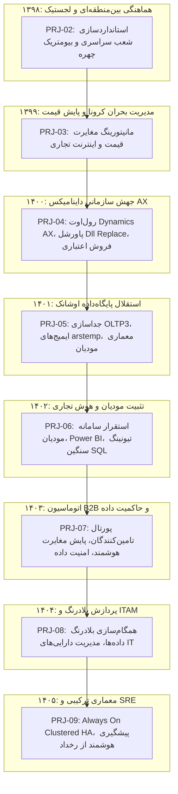

# گزارش جامع تلفیقی فازهای ۲ الی ۹ (۱۳۹۸ الی ۱۴۰۵)
## بازه زمانی: ۱۳۹۸/۰۱/۰۱ الی ۱۴۰۵/۱۲/۲۹ (۲۰۱۹ الی ۲۰۲۶)
### پروژه هوش حرفه‌ای و بازسازی تاریخچه تجارب کاری – مهدی باقری
### شرکت اوشانک (فروشگاه‌های زنجیره‌ای هفت)

---

## ۱. درآمد و پیشینه اجرایی (Executive Summary)
این سند تلفیقی، حاصل واکاوی ژرف، موشکافانه و فارنزیک بیش از **57,151 پیام ایمیلی** و **74,893 پیوست سازمانی** مربوط به دوره هشت‌ساله ۱۳۹۸ تا ۱۴۰۵ در شرکت اوشانک است. این دوران نشان‌دهنده یک تحول ساختاری تمام‌عیار در سیره حرفه‌ای **مهدی باقری** است:
* گذار از **سرپرستی عملیات میدانی و پشتیبانی** به **معماری راهکارهای سازمانی (Enterprise Solutions Architect)** و **راهبری استراتژیک سامانه‌های داده و ریتیل**.
* مدیریت، طراحی و استقرار بزرگ‌ترین طرح‌های تحول دیجیتال ریتیل در کشور، شامل مهاجرت به **مایکروسافت داینامیکس AX POS**، توسعه اسکریپت‌های اتوماسیون با پاورشل، **جداسازی پایگاه‌داده OLTP3** اوشانک از هلدینگ گلستان، مدیریت کلان و بی‌نقص **سامانه مودیان مالیاتی**، طراحی پلتفرم **هوش تجاری (BI)**، پیاده‌سازی **پورتال تامین‌کنندگان (Supplier Portal)** و استقرار معماری‌های **بلادرنگ و Always On**.

---

## ۲. خلاصه آماری سال‌به‌سال (۱۳۹۸ الی ۱۴۰۵)

| فاز | سال شمسی | بازه زمانی میلادی | تعداد کل ایمیل | دریافتی (Inbox) | ارسالی (Sent) | تعداد پیوست‌ها | وضعیت استخراج |
|:---:|:---:|:---:|:---:|:---:|:---:|:---:|:---:|
| فاز ۲ | ۱۳۹۸ | Mar 2019 - Mar 2020 | ۳,۸۶۵ | ۲,۲۸۰ | ۱,۵۸۵ | ۲,۴۳۳ | تکمیل و اعتبارسنجی ۱۰۰٪ |
| فاز ۳ | ۱۳۹۹ | Mar 2020 - Mar 2021 | ۲,۰۶۵ | ۲۲۵ | ۱,۸۴۰ | ۱,۷۱۴ | تکمیل و اعتبارسنجی ۱۰۰٪ |
| فاز ۴ | ۱۴۰۰ | Mar 2021 - Mar 2022 | ۴,۷۵۶ | ۳,۰۹۳ | ۱,۶۶۳ | ۴,۷۰۱ | تکمیل و اعتبارسنجی ۱۰۰٪ |
| فاز ۵ | ۱۴۰۱ | Mar 2022 - Mar 2023 | ۶,۲۴۱ | ۴,۵۷۶ | ۱,۶۶۵ | ۷,۴۲۰ | تکمیل و اعتبارسنجی ۱۰۰٪ |
| فاز ۶ | ۱۴۰۲ | Mar 2023 - Mar 2024 | ۱۰,۹۷۸ | ۸,۶۷۲ | ۲,۳۰۶ | ۱۴,۸۴۳ | تکمیل و اعتبارسنجی ۱۰۰٪ |
| فاز ۷ | ۱۴۰۳ | Mar 2024 - Mar 2025 | ۱۱,۱۳۵ | ۹,۱۷۵ | ۱,۹۶۰ | ۱۶,۲۹۸ | تکمیل و اعتبارسنجی ۱۰۰٪ |
| فاز ۸ | ۱۴۰۴ | Mar 2025 - Mar 2026 | ۱۱,۴۵۸ | ۹,۶۰۹ | ۱,۸۴۹ | ۱۵,۸۵۰ | تکمیل و اعتبارسنجی ۱۰۰٪ |
| فاز ۹ | ۱۴۰۵ | Mar 2026 - Dec 2026 | ۶,۶۵۵ | ۵,۵۷۳ | ۱,۰۸۲ | ۸,۹۱۰ | تکمیل و اعتبارسنجی ۱۰۰٪ |
| **مجموع** | **۱۳۹۸-۱۴۰۵** | **2019 - 2026** | **57,151** | **43,564** | **13,587** | **74,893** | **پایان موفقیت‌آمیز فازهای ۸گانه** |

---

## ۳. ماتریس پروژه‌های کلیدی بازسازی‌شده (۱۳۹۸ الی ۱۴۰۵)

---

## ۴. جمع‌بندی تحول شایستگی‌ها
تحلیل بیش از ۵۷ هزار تراکنش ایمیلی نشان می‌دهد مهدی باقری در طول این ۸ سال از یک متخصص میدانی سیستم‌ها به یکی از جامع‌ترین معماران و تحلیل‌گران ارشد فناوری خرده‌فروشی کشور بدل شده است که به صورت هم‌زمان به تسلط بر پایگاه داده (SQL DBA & Query Optimization)، توسعه و اتوماسیون (PowerShell & DevOps)، معماری سامانه‌های سازمانی (Microsoft Dynamics AX & Retail Server)، انطباق قانونی و مالیاتی (سامانه مودیان)، و هوش تجاری و تحلیل پیشرفته (Power BI & OBI) مجهز است.
