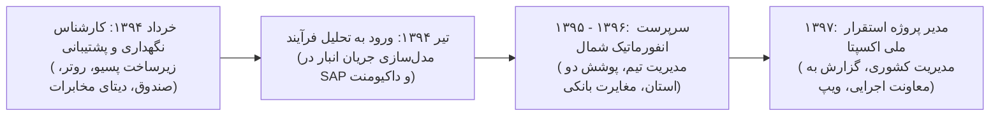

# گزارش تفصیلی فاز اول: دوران پایه‌گذاری، زیرساخت، راهبری عملیات و استقرار سامانه‌ها
## بازه زمانی: ۱۳۹۴ الی ۱۳۹۷ (مه ۲۰۱۵ الی مارس ۲۰۱۹)
### پروژه هوش حرفه‌ای و بازسازی تاریخچه تجارب کاری – مهدی باقری

---

## ۱. خلاصه اجرایی فاز اول (Executive Summary)
فاز اول (سال‌های ۱۳۹۴ تا پایان ۱۳۹۷)، دوره ورود، تثبیت، ارتقای سریع و گسترش چشمگیر مسئولیت‌های آقای **مهدی باقری** در شرکت **اوشانک (فروشگاه‌های زنجیره‌ای هفت)** است. 

شواهد مستند ایمیلی نشان می‌دهد که ایشان در خرداد ۱۳۹۴ به عنوان **کارشناس واحد نگهداری و پشتیبانی انفورماتیک** وارد سازمان شده و با بهره‌گیری از دانش عمیق قبلی در حوزه شبکه و سخت‌افزار، به سرعت فراتر از یک تکنسین پشتیبانی ظاهر شده است. در همان ماه‌های نخست، ایشان علاوه بر راه‌اندازی میدانی ده‌ها شعبه در استان‌های تهران و البرز، وارد عرصه **تحلیل فرآیندهای کسب‌وکار (Business Analysis)** شده و اولین چارت رسمی فرآیند گردش کالای انبار در سیستم SAP را مستند نمود.

در سال‌های ۱۳۹۵ الی ۱۳۹۷، ایشان به عنوان **سرپرست انفورماتیک منطقه شمال (استان‌های گیلان و مازندران)**، رهبری کامل عملیات فناوری اطلاعات، جذب و هدایت تیم فنی، راه‌اندازی زیرساخت شبکه و انبارهای رشت، استقرار ارتباطات تلفنی VoIP، حل مغایرت‌های مالی و بانکی پوزها با شرکت‌های PSP و مدیریت فنی انبارگردانی‌ها را برعهده گرفت. نقطه عطف اواخر این دوره در زمستان ۱۳۹۷، ارتقای ایشان به نقش **مدیر پروژه استقرار سراسری صندوق‌های مکانیزه فروش (Acepta POS)** در سطح کل مناطق کشور و ارائه داشبوردهای روزانه پیشرفت پروژه به معاونت اجرایی هلدینگ بوده است.

---

## ۲. مشخصات هویتی و ساختار سازمانی کشف‌شده
* **نام کامل:** مهدی باقری بیجاربنه (Mehdi Bagheri Bijarboneh)
* **پست الکترونیک:** `mbagheri@oshanak.com`
* **کدهای پرسنلی شناسایی‌شده:**
  * کد پرسنلی انبار (۱۳۹۴): `24110375`
  * کد پرسنلی دفتر مرکزی (۱۳۹۴): `24010080`
  * کد پرسنلی مصوب (۱۳۹۶ به بعد): `24210063`
  * شماره داخلی تلفن (۱۳۹۷): `3464`
* **عناوین رسمی سازمانی در طول این فاز:**
  1. *خرداد ۱۳۹۴ - شهریور ۱۳۹۴:* کارشناس واحد نگهداری و پشتیبانی انفورماتیک (دفتر مرکزی - برج سایه)
  2. *مهر ۱۳۹۴ - اسفند ۱۳۹۴:* کارشناس انفورماتیک منطقه رشت (مامور به انبار منطقه تهران)
  3. *فروردین ۱۳۹۵ - اسفند ۱۳۹۷:* سرپرست انفورماتیک منطقه شمال (گیلان و مازندران)
  4. *دی ۱۳۹۷ - اسفند ۱۳۹۷:* مدیر/هماهنگ‌کننده پروژه ملی استقرار صندوق‌های مکانیزه اکسپتا (Acepta POS)

---

## ۳. تحلیل پروژه‌های شاخص فاز اول

### پروژه ۱: راه‌اندازی زیرساخت شبکه و تجهیزات انبار مرکزی رشت و تهران (PRJ-01-001)
* **دوره زمانی:** خرداد ۱۳۹۴ – آبان ۱۳۹۴
* **دسته‌بندی:** زیرساخت شبکه، پسیو/اکتیو و اتوماسیون انبارداری
* **مسئله کسب‌وکار:** توسعه سریع فروشگاه‌های زنجیره‌ای هفت نیازمند انبارهای منطقه‌ای با پوشش کامل و بی‌نقص شبکه بی‌سیم برای پایانه‌های جمع‌آوری داده (هندهلدهای بارکدخوان) و ارتباط پایدار با سرور مرکزی بود.
* **نقش واقعی:** مهندس طراح و مجری زیرساخت شبکه و پسیو انبار
* **اقدامات انجام‌شده:**
  * بررسی و تحلیل نقشه‌های معماری و کابل‌کشی (AutoCAD DWG).
  * نصب و آرایش رک‌های شبکه، پچ‌پنل‌ها و سوییچ‌های سیسکو.
  * پیاده‌سازی پوشش رادیویی و نصب اکسس‌پوینت‌های صنعتی جهت تضمین رومینگ بدون قطعی هندهلدهای انبارداری.
  * حل مشکلات کانفیگ هندهلدها و رفع خطاهای اتصال به سرور محلی انبار.
* **دستاورد:** بهره‌برداری کامل از انبار مرکزی رشت و تسهیل فرآیند مکانیزه ورود و خروج کالا.

### پروژه ۲: برنامه ملی افتتاح و استقرار تجهیزات شعب زنجیره‌ای هفت (PRJ-01-002)
* **دوره زمانی:** تیر ۱۳۹۴ – اسفند ۱۳۹۴
* **دسته‌بندی:** فناوری خرده‌فروشی (Retail Technology) و عملیات شعب
* **مسئله کسب‌وکار:** افتتاح هفتگی چندین فروشگاه جدید در تهران و البرز در بازه‌های زمانی بسیار فشرده، نیاز به راه‌اندازی سریع زیرساخت IT و صندوق‌های فروش در موعد مقرر داشت.
* **نقش واقعی:** مسئول میدانی نصب، راه‌اندازی و تحویل‌گیری فروشگاه‌ها
* **اقدامات انجام‌شده:**
  * پیگیری و تحویل‌گیری خطوط دیتای مخابرات و تست کیفیت خط (Noise & Margin).
  * ارائه راهکار خلاقانه استفاده از دانگل‌های 3G/4G رایتل به عنوان لینک پشتیبان اضطراری در شعبی که مخابرات دچار تاخیر در رانژه خطوط بود (نظیر فروشگاه اسماعیل‌آباد).
  * نصب سیستم‌عامل، نرم‌افزار صندوق (Tera POS)، راه‌اندازی سرور لوکال فروشگاه، بارکدخوان، لیبل‌پرینتر و پایانه های بانکی.
  * استقرار در بیش از ۲۰ شعبه شامل: هفت‌تیر کرج، واوان، قدس ۱ و ۲، اندیشه ۱ و ۲، مارلیک، ملارد، گوهردشت، مهرشهر، رباط‌کریم، شهریار، نسیم‌شهر، گلستان، سلطان‌آباد، نازی‌آباد، پاستور و ابوذر.
* **دستاورد:** تضمین افتتاح به‌موقع تمام شعب برنامه‌ریزی‌شده با کمترین وقفه و پایه‌گذاری فرآیند چک‌لیست افتتاحیه.

### پروژه ۳: مستندسازی و مهندسی فرآیندهای لجستیک و زنجیره تامین (PRJ-01-003)
* **دوره زمانی:** تیر ۱۳۹۴ – مرداد ۱۳۹۴
* **دسته‌بندی:** تحلیل فرآیندهای کسب‌وکار (Business Analysis)
* **مسئله کسب‌وکار:** عدم وجود مستندات فرآیندی شفاف پیرامون جریان سفارش‌گذاری، ورود، کنترل، ضایعات و خروج کالا و نحوه انطباق آن با تراکنش‌های SAP ERP.
* **نقش واقعی:** تحلیل‌گر فرآیندهای کسب‌وکار (Business Analyst)
* **اقدامات انجام‌شده:**
  * نگارش سند تحلیلی «روند کار انبار» در تیرماه ۱۳۹۴.
  * تشریح و دیاگرام‌بندی فرآیند ۳گانه ورود کالا، مدیریت ضایعات و خروج کالا.
  * نگاشت فرآیند تامین تا انبار با استفاده از تراکنش‌های SAP از جمله دستور `ZRT96` (گزارش و کنترل موجودی انبار).
* **دستاورد:** ارائه اولین مدل فرآیندی رسمی انبارداری که به عنوان مبنای آموزش پرسنل زنجیره تامین و توسعه سیستم‌های نرم‌افزاری بعدی مورد استفاده قرار گرفت.

### پروژه ۴: توسعه، مدیریت و هدایت فناوری اطلاعات منطقه شمال (PRJ-01-004)
* **دوره زمانی:** فروردین ۱۳۹۵ – اسفند ۱۳۹۷
* **دسته‌بندی:** مدیریت عملیات IT، رهبری تیم و حاکمیت سازمانی
* **مسئله کسب‌وکار:** رشد سریع شبکه فروشگاهی در استان‌های گیلان و مازندران نیازمند تمرکززدایی از تهران و ایجاد یک واحد مستقل، پایدار و پاسخگو در شمال کشور بود.
* **نقش واقعی:** سرپرست و مدیر عملیات انفورماتیک منطقه شمال
* **اقدامات انجام‌شده:**
  * اخذ مجوز رسمی از مدیریت ارشد IT (رسول پوربابا) جهت استخدام کارشناسان بومی.
  * جذب، آموزش، منتورینگ و هدایت کارشناسان فنی (عزیزالله ضابط‌پور در مازندران و پدرام سیما در گیلان).
  * مدیریت و پشتیبانی فنی انبارگردانی‌های ماهانه و پایان سال در کلیه شعب و انبارها.
  * ارتقای نرم‌افزار هندهلدهای شعب به نسخه فارسی و آموزش مسئولین فروشگاه‌ها.
  * تعریف ساختار تیکتینگ و ارجاع کلیه مشکلات از طریق سامانه هلپ‌دسک سازمانی (کلیک).
* **دستاورد:** ایجاد یک بازوی عملیاتی بسیار قوی در شمال کشور با میانگین زمان رفع خرابی (MTTR) کمتر و رضایت کامل مدیران منطقه.

### پروژه ۵: استقرار شبکه تلفنی ویپ (VoIP) بین شعب و دفتر منطقه شمال (PRJ-01-005)
* **دوره زمانی:** اسفند ۱۳۹۶ – اردیبهشت ۱۳۹۷
* **دسته‌بندی:** زیرساخت ارتباطات شبکه و تلکام (VoIP Telephony)
* **مسئله کسب‌وکار:** هزینه‌های بالای مکالمات بین‌استانی و خطوط شهری شعب با سرپرستی منطقه و دفتر مرکزی و نیاز به راه‌اندازی شبکه تلفنی جامع مبتنی بر IP.
* **نقش واقعی:** طراح، پیاده‌ساز و پشتیبان شبکه ویپ
* **اقدامات انجام‌شده:**
  * پیکربندی روترهای سیسکو فروشگاه‌ها با تنظیمات DHCP Option 150 و Option 66 متصل به سرور تلفنی هلدینگ.
  * تعریف Static Routeهای بهینه روی روترها جهت روتینگ صوت بر روی بستر اینترانت.
  * تدوین داکیومنت اختصاصی «آموزش راه‌اندازی VoIP» و اشتراک‌گذاری با تیم شبکه.
* **دستاورد:** برقراری ارتباطات تلفنی داخلی رایگان، باکیفیت و پایدار در تمامی شعب مازندران و گیلان.

### پروژه ۶: ساماندهی پایانه‌های فروش بانکی (PSP) و مغایرت‌گیری مالی تراکنش‌ها (PRJ-01-006)
* **دوره زمانی:** شهریور ۱۳۹۵ – اسفند ۱۳۹۷
* **دسته‌بندی:** سیستم‌های پرداخت الکترونیک و تحلیل مالی
* **مسئله کسب‌وکار:** وجود مغایرت‌های مالی پراکنده میان مبالغ تراکنش‌های ثبت‌شده در صندوق فروشگاه و مبالغ واریز شده به حساب‌های بانکی شرکت از طریق سوییچ شاپرک.
* **نقش واقعی:** تحلیل‌گر پرداخت و مغایرت‌گیری مالی
* **اقدامات انجام‌شده:**
  * تعامل مستقیم با مدیران فنی و پذیرندگان شرکت‌های پرداخت الکترونیک سامان‌کیش (SEP) و پاسارگاد (PEP).
  * ردیابی ترمینال‌های دارای مغایرت بر اساس شماره ترمینال، تاریخ تراکنش و تاریخ ثبت بانک و استخراج تفاوت‌ها تا سطح ریال.
  * هماهنگی با واحد مالی شرکت (مرمر پرستار) جهت صدور سند انتقال وجه و جبران کسری‌ها.
* **دستاورد:** وصول مبالغ مغایرت، رفع اختلالات ارتباطی پوزهای شبکه و شفافیت حساب‌های بانکی فروشگاه‌ها.

### پروژه ۷: پروژه ملی استقرار سراسری صندوق‌های مکانیزه اکسپتا (PRJ-01-007)
* **دوره زمانی:** بهمن ۱۳۹۷ – اسفند ۱۳۹۷
* **دسته‌بندی:** سیستم‌های یکپارچه ریتیل (Enterprise Retail Rollout)
* **مسئله کسب‌وکار:** هلدینگ نیازمند جایگزینی و استقرار نسل جدید صندوق‌های مکانیزه فروش (نرم‌افزار اکسپتا) در صدها فروشگاه فعال سراسر کشور در آستانه شلوغی خریدهای شب عید بود.
* **نقش واقعی:** مدیر و هماهنگ‌کننده استقرار پروژه اکسپتا (Deployment Project Lead)
* **اقدامات انجام‌شده:**
  * برنامه‌ریزی تفصیلی استقرار شعب در مناطق تهران شرق، تهران غرب، گیلان، مازندران، قزوین-زنجان، مشهد و...
  * پایش و گزارش‌دهی روزانه پیشرفت استقرار (برنامه‌ریزی‌شده در برابر نصب‌شده) به شخص آقای محمدرضا حاجی (معاونت اجرایی).
  * مدیریت تحویل زودهنگام شعب (مانند نصب زودتر از موعد فروشگاه‌های قزوین و گیلان).
  * تولید و انتشار مستندات استقرار در پرتال سازمانی شیرپوینت در بخش KnowledgeBase.
  * تهیه فایل‌های آموزشی نحوه کاربری کیبورد و اعمال کارت‌های تخفیف باشگاه مشتریان برای صندوق‌داران.
* **دستاورد:** اجرای رکوردشکن پروژه بدون وقفه در فروش شب عید و تثبیت پلتفرم فروشگاهی اکسپتا در سطح ملی.

---

## ۴. تحول و تکامل مهارت‌ها در فاز اول (Career Progression)

1. **انتقال از سطح کارشناسی فنی به سرپرستی و راهبری منطقه‌ای:** مهدی باقری در عرض کمتر از یک سال از یک کارشناس اجرایی به سرپرست منطقه شمال تبدیل شد که اختیارات جذب نیرو، تقسیم کار، آموزش و نظارت بر پرسنل را دارا بود.
2. **بلوغ در تحلیل کسب‌وکار و مسائل مالی:** درک عمیق از فرآیندهای مالی (مغایرت‌های بانکی، تسویه روزانه، انبارگردانی) که ایشان را از یک مهندس شبکه صرف، به یک تحلیل‌گر فرآیندهای ریتیل تبدیل کرد.
3. **مدیریت پروژه‌های کلان سازمانی:** در پایان فاز اول، ایشان مهارت‌های رهبری پروژه و مدیریت ذی‌نفعان در سطح مدیران ارشد هلدینگ را با موفقیت در پروژه استقرار اکسپتا به اثبات رساند.

---

## ۵. شواهد مستند و قابلیت ردیابی (Traceability)
تمام پروژه‌ها و ادعاهای این گزارش به همراه کد شناسه ایمیل، فرستنده، تاریخ دقیق و متن پیام در فایل اکسل `07_Evidence\Evidence_Index.xlsx` و فایل `02_Project_History\Complete_Project_History.xlsx` ثبت و اعتبارسنجی شده است.
