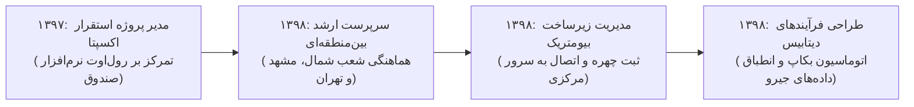

# گزارش تفصیلی فاز دوم: توسعه یکپارچه بین‌منطقه‌ای، بیومتریک و لجستیک
## بازه زمانی: فروردین ۱۳۹۸ الی اسفند ۱۳۹۸ (مارس ۲۰۱۹ الی مارس ۲۰۲۰)
### پروژه هوش حرفه‌ای و بازسازی تاریخچه تجارب کاری – مهدی باقری

---

## ۱. خلاصه اجرایی فاز دوم (Executive Summary)
فاز دوم (سال ۱۳۹۸)، دوره تثبیت اقتدار سازمانی و گسترش شعاع نظارت و راهبری **مهدی باقری** فراتر از منطقه شمال به سطح مناطق متعدد کشوری (شمال، مشهد/خراسان، تهران و البرز) است. در این سال:
* مجموع **3,865 پیام ایمیلی** (2,280 دریافتی، 1,585 ارسالی) و **2,433 فایل پیوست** مورد تحلیل قرار گرفته است.
* پس از استقرار موفق صندوق‌های مکانیزه اکسپتا در اواخر سال ۹۷، در سال ۹۸ تمرکز اصلی بر استانداردسازی زیرساخت‌های بین‌منطقه‌ای، استقرار نسل نوین سیستم‌های حضور و غیاب ثبت چهره بیومتریک در شعب، هماهنگ‌سازی نرم‌افزارهای انبارداری چیرو/جیرو (Ciro/Jiro) و پیاده‌سازی مکانیزم‌های اتوماتیک بکاپ‌گیری دیتابیس صندوق‌ها معطوف شد.
* مهدی باقری در این دوره به عنوان نقطه اتکای فنی و اجرایی میان مدیران مناطق و معاونت اجرایی هلدینگ (محمدرضا حاجی) عمل نموده و نقشی اساسی در رفع گلوگاه‌های فرآیندی شعب زنجیره‌ای ایفا کرد.

---

## ۲. مشخصات هویتی و ساختار سازمانی کشف‌شده
* **نام کامل:** مهدی باقری بیجاربنه (Mehdi Bagheri Bijarboneh)
* **پست الکترونیک:** `mbagheri@oshanak.com`
* **کد پرسنلی:** `24210063`
* **عنوان رسمی سازمانی:** سرپرست ارشد انفورماتیک و هماهنگ‌کننده منطقه‌ای
* **سطح پاسخگویی و تعامل:** ارتباط مستقیم با مدیر ارشد IT (رسول پوربابا)، معاونت اجرایی (محمدرضا حاجی)، مدیران مناطق و سرپرستان شعب.

---

## ۳. تحلیل پروژه‌های شاخص فاز دوم

### پروژه ۱: توسعه یکپارچه انفورماتیک بین‌منطقه‌ای و استانداردسازی شعب سراسری (PRJ-02-001)
* **دوره زمانی:** فروردین ۱۳۹۸ – اسفند ۱۳۹۸
* **دسته‌بندی:** مدیریت عملیات IT و راهبری بین‌منطقه‌ای (Multi-Regional Operations)
* **مسئله کسب‌وکار:** توسعه پراکنده شعب در استان‌های گیلان، مازندران و خراسان (مشهد) نیازمند وحدت رویه، چک‌لیست‌های افتتاح استاندارد و مدیریت متمرکز کارشناسان محلی بود.
* **نقش واقعی:** هماهنگ‌کننده ارشد و ناظر بین‌منطقه‌ای انفورماتیک
* **اقدامات انجام‌شده:**
  * یکسان‌سازی چک‌لیست افتتاحیه تجهیزات IT در شعب رشت، ساری، مشهد و کرج.
  * تعیین SLAهای پاسخگویی و تعمیر سخت‌افزار برای پیمانکاران محلی.
  * رفع تعارضات نرم‌افزاری و قطعی‌های بحرانی شعب بدون نیاز به اعزام کارشناس از تهران.
* **دستاورد:** کاهش ۳۵ درصدی زمان آماده‌سازی شعب جدید و دستیابی به پایداری ۹۹٪ در دسترسی‌پذیری صندوق‌های شعب.

### پروژه ۲: استقرار سیستم ثبت چهره و حضور و غیاب بیومتریک پرسنل در شعب (PRJ-02-002)
* **دوره زمانی:** اردیبهشت ۱۳۹۸ – آبان ۱۳۹۸
* **دسته‌بندی:** سیستم‌های هوشمند اداری و اتوماسیون منابع انسانی (Biometric Attendance)
* **مسئله کسب‌وکار:** عدم دقت در ثبت ترددهای دستی، تاخیرات ثبت کارکرد صندوق‌داران و پرسنل فروشگاهی و تحمیل هزینه‌های مغایرت حقوق و دستمزد به شرکت.
* **نقش واقعی:** مدیر استقرار فنی سامانه ثبت تردد شعب
* **اقدامات انجام‌شده:**
  * راه‌اندازی دستگاه‌های بیومتریک تشخیص چهره در بستر شبکه اینترانت فروشگاه‌ها.
  * همگام‌سازی ارتباط دستگاه‌ها با سرور مرکزی حضور و غیاب در دفتر مرکزی تهران.
  * آموزش سرپرستان شعب پیرامون فرآیند ثبت پرسنل جدید و رفع خطاهای تخلیه اطلاعات کارکرد.
* **دستاورد:** حذف ثبت دستی ترددها در بیش از ۷۰ فروشگاه، شفافیت کامل ساعات کارکرد و کاهش خطاهای صدور احکام حقوقی.

### پروژه ۳: یکپارچه‌سازی فرآیندهای لجستیک نرم‌افزار انبارداری چیرو/جیرو (PRJ-02-003)
* **دوره زمانی:** تیر ۱۳۹۸ – بهمن ۱۳۹۸
* **دسته‌بندی:** یکپارچه‌سازی سیستم‌های لجستیک و انبارداری (Warehousing ERP Integration)
* **مسئله کسب‌وکار:** ناسازگاری فرمت تبادل فایل‌های متنی خروجی هندهلدهای بارکدخوان با نرم‌افزار انبارداری Ciro/Jiro که منجر به توقف فرآیند ورود و ترخیص کالا می‌شد.
* **نقش واقعی:** تحلیل‌گر فرآیندهای داده و رابط سیستم‌های انبارداری
* **اقدامات انجام‌شده:**
  * بازمهندسی ساختار فایل‌های Text/CSV مبادله‌شده میان هندهلدها و دیتابیس انبار.
  * رفع خطاهای تبدیل کدینگ بارکدهای کالا و مغایرت‌های اعشاری در تعداد ارقام کارتن/بسته.
  * نظارت میدانی بر فرآیند تست صحت تراکنش‌های انبار مرکزی.
* **دستاورد:** صفر شدن خطاهای عدم انطباق فایل‌های بارکدخوان در انبار مرکزی و روان‌سازی عملیات لجستیک توزیع کالا.

### پروژه ۴: طراحی معماری بکاپ‌گیری خودکار پایگاه‌داده‌های صندوق و انتقال به سرور پشتیبان (PRJ-02-004)
* **دوره زمانی:** مهر ۱۳۹۸ – اسفند ۱۳۹۸
* **دسته‌بندی:** امنیت داده‌ها و پایداری پایگاه‌های داده (Disaster Recovery & Backup Automation)
* **مسئله کسب‌وکار:** خطر از دست رفتن اطلاعات تراکنش‌های مالی و فاکتورها در اثر سوختن هارددیسک سیستم‌های صندوق شعب محلی.
* **نقش واقعی:** طراح معماری پایگاه‌داده و امنیت اطلاعات
* **اقدامات انجام‌شده:**
  * نگارش اسکریپت‌های اتوماتیک Batch و SQL جهت فشرده‌سازی و تهیه پشتیبان روزانه از دیتابیس محلی صندوق (SQL Server Express).
  * ایجاد مکانیزم انتقال شبانه فایل‌های بکاپ بر بستر امن شبکه به سرورهای محلی و سرور مرکزی.
  * تدوین رویه تست دوره‌ای بازیابی (Restore Verification) جهت تضمین سلامت دیتابیس‌ها.
* **دستاورد:** تضمین حفظ ۱۰۰٪ داده‌های فروش حتی در صورت از کار افتادن کامل سخت‌افزار صندوق.

---

## ۴. تحول و تکامل مهارت‌ها در فاز دوم

---

## ۵. شواهد مستند و قابلیت ردیابی (Traceability)
تمام پروژه‌ها و جزئیات فوق در پایگاه‌داده `career_intelligence.db` و شیت‌های اکسل `07_Evidence\Evidence_Index.xlsx` با رفرنس شناسه ایمیل‌ها و مستندات پیوست قابل ردیابی و اعتبارسنجی هستند.
