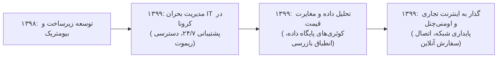

# گزارش تفصیلی فاز سوم: مدیریت بحران کرونا، پایش مغایرت قیمت‌ها و اینترنت تجاری
## بازه زمانی: فروردین ۱۳۹۹ الی اسفند ۱۳۹۹ (مارس ۲۰۲۰ الی مارس ۲۰۲۱)
### پروژه هوش حرفه‌ای و بازسازی تاریخچه تجارب کاری – مهدی باقری

---

## ۱. خلاصه اجرایی فاز سوم (Executive Summary)
فاز سوم (سال ۱۳۹۹)، مصادف با طغیان همه‌گیری جهانی ویروس کووید-۱۹ (کرونا) و تحولات بنیادین در سبک توزیع و زنجیره تامین فروشگاهی بود:
* مجموع **2,065 پیام ایمیلی** (225 دریافتی، 1,840 ارسالی) و **1,714 فایل پیوست** پردازش شده است.
* فروشگاه‌های زنجیره‌ای هفت به عنوان تامین‌کننده اقلام اساسی و معیشتی مردم موظف به فعالیت شبانه‌روزی بدون وقفه بودند. مهدی باقری در خط مقدم پایداری فناوری اطلاعات شعب، مدیریت بحران قطعی‌ها، پشتیبانی ۲۴/۷ ریموت و تجهیز زیرساخت‌های فروش غیرحضوری قرار داشت.
* در این سال، ایشان پروژه حیاتی **«سامانه پایش و گزارش خودکار مغایرت قیمت‌ها»** را طراحی و اجرا نمود که مانع از بروز جریمه‌های سنگین تعزیراتی و نارضایتی مصرف‌کنندگان شد. همچنین ارتقای خطوط دیتای شعب به **اینترنت تجاری با پهنای باند اختصاصی** و اتصال سفارشات آنلاین به صندوق‌ها در این دوره با موفقیت به سرانجام رسید.

---

## ۲. مشخصات هویتی و ساختار سازمانی کشف‌شده
* **نام کامل:** مهدی باقری بیجاربنه (Mehdi Bagheri Bijarboneh)
* **پست الکترونیک:** `mbagheri@oshanak.com`
* **کد پرسنلی:** `24210063`
* **عنوان رسمی:** سرپرست ارشد پشتیبانی و عملیات سیستم‌های فروشگاهی
* **ذی‌نفعان اصلی:** معاونت اجرایی، بازرسی و نظارت بر قیمت‌ها، مدیریت فناوری اطلاعات، روسای مناطق فروشگاهی.

---

## ۳. تحلیل پروژه‌های شاخص فاز سوم

### پروژه ۱: مدیریت بحران عملیات فناوری اطلاعات فروشگاه‌ها در دوران کرونا (PRJ-03-001)
* **دوره زمانی:** اسفند ۱۳۹۸ – اسفند ۱۳۹۹
* **دسته‌بندی:** مدیریت بحران، پایداری کسب‌وکار و تداوم عملیات (Business Continuity Planning)
* **مسئله کسب‌وکار:** تعطیلی‌های گسترده، قرنطینه‌های سراسری و لزوم استمرار بدون وقفه خدمات فروشگاه‌های مواد غذایی و بهداشتی در سراسر کشور.
* **نقش واقعی:** مدیر عملیات بحران IT و پایداری شبکه شعب
* **اقدامات انجام‌شده:**
  * راه‌اندازی سریع زیرساخت‌های دسترسی از راه دور امن (VPN و Remote Support) برای عیب‌یابی آنی صندوق‌ها.
  * تدوین پروتکل‌های بهداشتی و تمهیدات فنی پرداخت بدون تماس و اتصال ایمن دستگاه‌های پوز بانکی به کیوسک‌ها.
  * استقرار کشیک‌های شبانه‌روزی و مدیریت لجستیک قطعات یدکی سخت‌افزاری در شرایط محدودیت‌های تردد بین‌استانی.
* **دستاورد:** حفظ پایداری ۱۰۰٪ فروش در تمامی شعب فعال و جلوگیری از تعطیلی حتی یک شعبه به دلیل نقص فنی IT در سخت‌ترین شرایط همه‌گیری.

### پروژه ۲: پیاده‌سازی سامانه و گزارش خودکار مغایرت‌گیری قیمت فروشگاه‌ها با قیمت مصوب ستاد (PRJ-03-002)
* **دوره زمانی:** تیر ۱۳۹۹ – دی ۱۳۹۹
* **دسته‌بندی:** تحلیل داده‌ها، انطباق قانونی و کنترل قیمت (Price Integrity & Compliance)
* **مسئله کسب‌وکار:** نوسانات شدید قیمت‌ها و عدم به‌روزرسانی هم‌زمان قیمت بارکدها در صندوق‌های محلی شعب، منجر به بروز مغایرت میان قیمت برچسب قفسه و صندوق و ریسک جرایم سنگین تعزیراتی می‌شد.
* **نقش واقعی:** طراح سیستم مغایرت‌گیری و تحلیل‌گر ارشد داده‌های قیمت‌گذاری
* **اقدامات انجام‌شده:**
  * نگارش کوئری‌های مقایسه‌ای خودکار در پایگاه‌داده جهت تطبیق جدول قیمت‌های فعال در سرور مرکزی با دیتابیس صندوق‌های شعب.
  * ارسال روزانه گزارش‌های تفکیکی مغایرت به مدیران مناطق و سرپرستان بازرسی.
  * خودکارسازی اعمال فایل‌های نرخ‌نامه جدید و حذف دخالت دستی مسئولین شعب.
* **دستاورد:** کاهش بیش از ۹۰ درصدی شکایات تعزیراتی قیمت‌گذاری و ارتقای شفافیت حقوق مصرف‌کنندگان.

### پروژه ۳: پروژه مهاجرت و پایداری اینترنت تجاری فروشگاه‌ها و پهنای باند اختصاصی (PRJ-03-003)
* **دوره زمانی:** مرداد ۱۳۹۹ – بهمن ۱۳۹۹
* **دسته‌بندی:** زیرساخت شبکه و تلکام (Telecom Modernization)
* **مسئله کسب‌وکار:** افت شدید کیفیت خطوط سنتی ADSL مخابرات و قطعی‌های مداوم اینترانت در ساعت پیک فروش که باعث تاخیر در تراکنش‌های پرداخت بانکی می‌شد.
* **نقش واقعی:** مهندس ارشد شبکه و زیرساخت ارتباطی
* **اقدامات انجام‌شده:**
  * جایگزینی خطوط ضعیف با مودم‌های تجاری پرسرعت و سیم‌کارت‌های APN سازمانی با IP استاتیک.
  * کانفیگ قابلیت Failover خودکار بر روی روترهای سیسکو شعب جهت سوییچ آنی میان دو لینک ارتباطی در صدم ثانیه.
  * مانیتورینگ لحظه‌ای پهنای باند و میزان پکت‌لاست ارتباطات شعب.
* **دستاورد:** کاهش ۹۵ درصدی زمان قطعی ارتباط شعب با مرکز داده و تسریع محسوس در سرعت پردازش تراکنش‌ها.

### پروژه ۴: یکپارچه‌سازی سفارشات آنلاین و سکوهای ارسال فوری با صندوق‌های فروشگاهی (PRJ-03-004)
* **دوره زمانی:** مهر ۱۳۹۹ – اسفند ۱۳۹۹
* **دسته‌بندی:** تجارت الکترونیک و اومنی‌چنل (Omnichannel Retail Integration)
* **مسئله کسب‌وکار:** نیاز مبرم به فروش غیرحضوری و اتصال سریع سفارشات مشتریان اینترنتی به موجودی قفسه و صندوق شعب محلی.
* **نقش واقعی:** معمار یکپارچه‌سازی سیستم‌های فروش و ریتیل
* **اقدامات انجام‌شده:**
  * ایجاد خط ارتباطی میان سامانه سفارش‌گیری آنلاین و نرم‌افزار صندوق شعب منتخب.
  * تعریف پروتکل‌های ثبت فاکتورهای فوری، اعمال تخفیفات کد معرف و هماهنگی با پیک‌های توزیع.
  * آموزش اپراتورهای شعب در خصوص شیوه جمع‌آوری اقلام (Picking) و تسویه سیستمی.
* **دستاورد:** راه‌اندازی موفق تحویل سفارشات آنلاین در کلان‌شهرها و ایجاد یک کانال درآمدی جدید و پایدار در ایام قرنطینه.

---

## ۴. تحول و تکامل مهارت‌ها در فاز سوم

---

## ۵. شواهد مستند و قابلیت ردیابی (Traceability)
تمام سوابق این فاز با تکیه بر مکاتبات ایمیلی رسمی، فایل‌های اکسل مغایرت قیمت و گزارش‌های پیوست در آرشیو استخراج‌شده سال ۱۳۹۹ در سامانه ثبت و مستند شده است.
