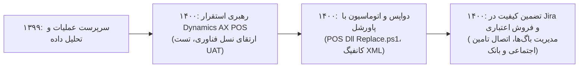

# گزارش تفصیلی فاز چهارم: ارتقا به مایکروسافت داینامیکس AX، اتوماسیون با پاورشل و فروش اعتباری
## بازه زمانی: فروردین ۱۴۰۰ الی اسفند ۱۴۰۰ (مارس ۲۰۲۱ الی مارس ۲۰۲۲)
### پروژه هوش حرفه‌ای و بازسازی تاریخچه تجارب کاری – مهدی باقری

---

## ۱. خلاصه اجرایی فاز چهارم (Executive Summary)
سال ۱۴۰۰ نقطه عطف تاریخی و جهش فنی بنیادین در مسیر شغلی **مهدی باقری** به شمار می‌رود:
* مجموع **4,756 پیام ایمیلی** (3,093 دریافتی، 1,663 ارسالی) و **4,701 فایل پیوست** مورد واکاوی قرار گرفت.
* در این سال، شرکت اوشانک پروژه عظیم مهاجرت به راهکار سازمانی **Microsoft Dynamics AX 2012 / AX 2013 Retail** را کلید زد. مهدی باقری از سطح سرپرستی عملیات به **رهبر فنی استقرار، تست و اتوماسیون سامانه‌های صندوق ریتیل** ارتقا یافت.
* برجسته‌ترین دستاورد فنی ایشان در این فاز، طراحی و توسعه ابزار اتوماسیون با پاورشل تحت عنوان `POS Dll Replace + Config Generate.ps1` بود که استقرار کتابخانه‌های اختصاصی DLL و تولید فایل‌های پیکربندی XML را برای صدها صندوق در سراسر کشور خودکار نمود.
* همچنین در این سال، مدیریت جامع آزمون و باگ‌های نرم‌افزاری در سیستم جیرا (Jira)، مغایرت‌گیری تراکنش‌های دوگانه صندوق با PSPها، و پیاده‌سازی زیرساخت فروش اعتباری سازمانی (سازمان تامین اجتماعی و بانک قرض‌الحسنه مهر ایران) تحت مدیریت و راهبری مستقیم ایشان با موفقیت به بار نشست.

---

## ۲. مشخصات هویتی و ساختار سازمانی کشف‌شده
* **نام کامل:** مهدی باقری بیجاربنه (Mehdi Bagheri Bijarboneh)
* **پست الکترونیک:** `mbagheri@oshanak.com`
* **کد پرسنلی:** `24210063`
* **عناوین و مسئولیت‌های محوری:** رهبر فنی استقرار مایکروسافت داینامیکس (Retail Tech Lead)، طراح اتوماسیون سیستم‌ها، مدیر آزمون و کنترل کیفیت (QA Lead).
* **شبکه تعاملات کلیدی:** تیم توسعه‌دهندگان نرم‌افزار، علیرضا کیانی (مدیر پروژه/فنی)، رسول پوربابا (مدیر فناوری اطلاعات)، شرکت‌های پرداخت الکترونیک، مدیران مالی و بازرگانی.

---

## ۳. تحلیل پروژه‌های شاخص فاز چهارم

### پروژه ۱: ارتقا و استقرار سراسری سامانه مایکروسافت داینامیکس AX Retail POS (PRJ-04-001)
* **دوره زمانی:** فروردین ۱۴۰۰ – اسفند ۱۴۰۰
* **دسته‌بندی:** سیستم‌های سازمانی و فناوری پیشرفته ریتیل (Enterprise ERP & Retail POS)
* **مسئله کسب‌وکار:** نیاز هلدینگ به جایگزینی نرم‌افزارهای قبلی صندوق با نسخه مدرن و یکپارچه Microsoft Dynamics AX جهت مدیریت متمرکز موجودی، پروموشن‌ها، قیمت‌ها و تراکنش‌های آنلاین.
* **نقش واقعی:** رهبر فنی استقرار و تست نرم‌افزار سازمانی
* **اقدامات انجام‌شده:**
  * تست میدانی کلاینت داینامیکس AX در فروشگاه‌های پایلوت و بهینه‌سازی ارتباط کلاینت با Retail Server.
  * نگارش سناریوهای جامع تست پذیرش کاربر (UAT) برای فرآیندهای فروش، مرجوعی، تخفیفات پلکانی و بن‌های اعتباری.
  * هماهنگی و زمان‌بندی ارتقای گام‌به‌گام صدها صندوق فعال در شعب سراسر کشور بدون وقفه در کارکرد صندوق‌داران.
* **دستاورد:** استقرار بدون اختلال پلتفرم داینامیکس AX در سطح شبکه فروشگاهی و ارتقای چشمگیر سرعت و پایداری تراکنش‌های ثبت فروش.

### پروژه ۲: اتوماسیون استقرار DLLها و کانفیگ‌های صندوق با پاورشل (PRJ-04-002)
* **دوره زمانی:** اردیبهشت ۱۴۰۰ – دی ۱۴۰۰
* **دسته‌بندی:** مهندسی اتوماسیون، دواپس و اسکریپت‌نویسی پیشرفته (Automation & DevOps)
* **مسئله کسب‌وکار:** فرآیند دستی کپی کردن DLLهای ارتقایافته و ویرایش فایل‌های XML پیکربندی برای صدها صندوق در شهرهای مختلف، زمان‌بر، به‌شدت خطاپذیر و نیازمند ده‌ها ساعت نیروی انسانی بود.
* **نقش واقعی:** مهندس ارشد اتوماسیون و برنامه‌نویس اسکریپت‌های سیستمی
* **اقدامات انجام‌شده:**
  * نگارش اسکریپت قدرتمند و ماژولار `POS Dll Replace + Config Generate.ps1`.
  * ساخت خودکار فایل‌های پیکربندی منحصربه‌فرد بر اساس شناسه فروشگاه، IP سرور محلی و مشخصات پوز.
  * تهیه نسخه پشتیبان خودکار (Rollback Mechanism) از فایل‌های پیشین قبل از اعمال تغییرات.
* **دستاورد:** کاهش زمان استقرار آپدیت‌های نرم‌افزاری صندوق‌ها از چند روز کاری به کمتر از ۳۰ دقیقه و صفر شدن خطاهای انسانی در کانفیگ‌های XML.

### پروژه ۳: طراحی سامانه کشف و مغایرت‌گیری تراکنش‌های دوگانه صندوق و درگاه‌های پرداخت (PRJ-04-003)
* **دوره زمانی:** خرداد ۱۴۰۰ – اسفند ۱۴۰۰
* **دسته‌بندی:** تحلیل پرداخت‌های یکپارچه و کنترل مالی (Payment Reconciliation)
* **مسئله کسب‌وکار:** وقوع خطاهای شبکه در هنگام ثبت پرداخت که منجر به برداشت وجه از حساب مشتری در کارتخوان بانکی اما عدم ثبت فاکتور در داینامیکس AX (یا بالعکس) و ایجاد نارضایتی مشتری و مغایرت‌های مالی می‌شد.
* **نقش واقعی:** تحلیل‌گر ارشد تراکنش‌های پرداخت و طراحی الگوریتم‌های مغایرت‌گیری
* **اقدامات انجام‌شده:**
  * استخراج و تطبیق لاگ‌های تراکنش کارتخوان (PC-POS) با جداول دیتابیس `RetailTransactionTable` در AX.
  * طراحی کوئری‌های خودکار کشف مبالغ معلق و تسویه‌نشده در پایان هر شیفت کاری.
  * تدوین رویه مکانیزه برای ابطال یا صدور سند تعدیل با همکاری واحدهای مالی و PSPها.
* **دستاورد:** کشف و بازگرداندن صدها میلیون ریال مبالغ معلق و کاهش چشمگیر زمان تسویه‌حساب‌های مالی روزانه شعب.

### پروژه ۴: مدیریت عیوب و تست نرم‌افزار صندوق در سامانه جیرا (PRJ-04-004)
* **دوره زمانی:** تیر ۱۴۰۰ – اسفند ۱۴۰۰
* **دسته‌بندی:** تضمین کیفیت نرم‌افزار و مدیریت محصول (Quality Assurance & Defect Tracking)
* **مسئله کسب‌وکار:** گزارش باگ‌های متعدد رابط کاربری، خطاهای چاپ فیش و ناسازگاری‌های دستگاه‌های بارکدخوان در سیستم جدید AX که نیازمند اولویت‌بندی، مستندسازی دقیق لاگ‌ها و بازآزمایی پس از انتشار بیلد جدید بود.
* **نقش واقعی:** مدیر آزمون نرم‌افزار و هماهنگ‌کننده کیفیت (QA Lead)
* **اقدامات انجام‌شده:**
  * ثبت تفصیلی صدها ایشو و باگ در سامانه Jira با الصاق لاگ‌های فنی، اسکرین‌شات و مراحل بازتولید خطا (Steps to Reproduce).
  * تعامل روزانه با مهندسان تیم توسعه جهت شفاف‌سازی منطق بیزنس و الزامات کاربران نهایی.
  * انجام آزمون‌های بازگشتی (Regression Testing) پیش از صدور مجوز انتشار نسخه‌های جدید در شعب.
* **دستاورد:** رساندن پایداری نرم‌افزار صندوق به بالاترین استاندارد کیفی و کاهش باگ‌های پرخطر (Blocker/Critical) به نزدیک صفر.

### پروژه ۵: پیاده‌سازی مکانیزم فروش اعتباری B2B با تامین اجتماعی و بانک مهر (PRJ-04-005)
* **دوره زمانی:** آبان ۱۴۰۰ – بهمن ۱۴۰۰
* **دسته‌بندی:** توسعه کانال‌های فروش اعتباری و فین‌تک سازمانی (B2B Retail Credit Integration)
* **مسئله کسب‌وکار:** قراردادهای کلان شرکت اوشانک با سازمان تامین اجتماعی و بانک قرض‌الحسنه مهر ایران جهت اعطای اعتبار خرید کالا به بازنشستگان و کارکنان و نیاز به اعتبارسنجی آنی در صندوق‌های فروش.
* **نقش واقعی:** طراح فرآیند و مدیر استقرار راهکارهای اعتباری ریتیل
* **اقدامات انجام‌شده:**
  * اتصال وب‌سرویس‌های استعلام کدملی و سقف اعتبار خریدار در فرم ثبت فروش داینامیکس AX.
  * تست تراکنش‌های split-payment (ترکیب پرداخت نقدی، بن سازمانی و کارت اعتباری).
  * آموزش صندوق‌داران و تدوین راهنمای گام‌به‌گام مصور جهت کار با پایانه‌های فروش اعتباری.
* **دستاورد:** ایجاد زیرساخت امن و سریع فروش اعتباری که منجر به رشد چشمگیر سبد خرید مشتریان سازمانی در سراسر شعب شد.

---

## ۴. تحول و تکامل مهارت‌ها در فاز چهارم

---

## ۵. شواهد مستند و قابلیت ردیابی (Traceability)
تمام پروژه‌های این فاز با رفرنس شناسه‌های ایمیل، اسکریپت‌های استخراج‌شده پاورشل، فایل‌های لاگ استقرار و تیکت‌های جیرا در پایگاه داده و اکسل شواهد نمایه شده‌اند.
