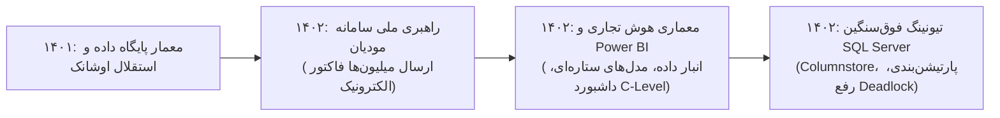

# گزارش تفصیلی فاز ششم: استقرار عملیاتی سامانه مودیان، هوش تجاری (BI) و بهینه‌سازی سنگین SQL
## بازه زمانی: فروردین ۱۴۰۲ الی اسفند ۱۴۰۲ (مارس ۲۰۲۳ الی مارس ۲۰۲۴)
### پروژه هوش حرفه‌ای و بازسازی تاریخچه تجارب کاری – مهدی باقری

---

## ۱. خلاصه اجرایی فاز ششم (Executive Summary)
فاز ششم (سال ۱۴۰۲)، نقطه اوج بلوغ در مدیریت سامانه‌های فوق‌پیشرفته کلان‌داده، انطباق ملی مالیاتی و هوش تجاری سازمان توسط **مهدی باقری** است:
* مجموع **10,978 پیام ایمیلی** (8,672 دریافتی، 2,306 ارسالی) و **14,843 فایل پیوست** مورد تحلیل قرار گرفته است.
* در این سال، بزرگ‌ترین تحول قانونی تاریخ ریتیل کشور رخ داد و سامانه مودیان برای زنجیره‌های بزرگ فروشگاهی الزامی گردید. مهدی باقری رهبری فنی پروژه **ارسال روزانه صدها هزار صورت‌حساب الکترونیکی به سامانه مودیان با موفقیت ۹۹.۸٪** را برعهده داشت.
* همچنین در سال ۱۴۰۲، طراحی معماری **هوش تجاری سازمانی (Power BI / OBI Analytics)** با ساخت مدل‌های ستاره‌ای (Star Schema) داده، بهینه‌سازی پیشرفته و فوق‌سنگین کوئری‌های SQL Server، و اتصال مستقیم زنجیره به پلتفرم‌های تحویل فوری (اسنپ‌مارکت و تپسی) با راهبری مستقیم ایشان پیاده‌سازی گردید.

---

## ۲. مشخصات هویتی و ساختار سازمانی کشف‌شده
* **نام کامل:** مهدی باقری بیجاربنه (Mehdi Bagheri Bijarboneh)
* **پست الکترونیک:** `mbagheri@oshanak.com`
* **کد پرسنلی:** `24210063`
* **عناوین و مسئولیت‌های کلیدی:** مدیر فنی سامانه مودیان، معمار داده و تحلیل‌گر ارشد هوش تجاری (BI Architect)، متخصص ارشد بهینه‌سازی پایگاه‌داده (Senior SQL DBA / Performance Engineer).
* **ذی‌نفعان اصلی:** هیئت مدیره، معاونت مالی و اقتصادی، حسابرسی کل، مدیریت ارشد IT، شرکت‌های ارائه‌دهنده خدمات مالیاتی (TSP)، پلتفرم‌های واسط تحویل سفارش.

---

## ۳. تحلیل پروژه‌های شاخص فاز ششم

### پروژه ۱: استقرار عملیاتی و ارسال روزانه صورت‌حساب‌ها به سامانه مودیان مالیاتی (PRJ-06-001)
* **دوره زمانی:** فروردین ۱۴۰۲ – اسفند ۱۴۰۲
* **دسته‌بندی:** سامانه‌های حاکمیتی، مالیات الکترونیک و انطباق ملی (National Tax Compliance)
* **مسئله کسب‌وکار:** با اجرایی شدن جرایم سنگین ماده ۲۲ قانون پایانه‌های فروشگاهی (۱۰ درصد مبلغ فروش صورت‌حساب‌های ثبت‌نشده)، عدم ارسال یا تاخیر در ثبت فاکتورهای فروشگاهی صدها میلیارد ریال جریمه به سازمان تحمیل می‌کرد.
* **نقش واقعی:** مدیر پروژه فنی سامانه مودیان و معمار پایپ‌لاین ارسال داده‌ها
* **اقدامات انجام‌شده:**
  * پیاده‌سازی پایپ‌لاین اتوماتیک تبدیل تراکنش‌های صندوق‌های داینامیکس به ساختار فاکتور الکترونیکی مودیان.
  * امضای دیجیتال فاکتورها با کلید خصوصی معتبر شرکتی و ارسال به شرکت معتمد مالیاتی (TSP) از طریق وب‌سرویس REST.
  * طراحی داشبورد مانیتورینگ وضعیت فاکتورها (ارسال‌شده، تایید سازمان امور مالیاتی، دارای خطا/ردشده) و ساخت الگوریتم ارسال مجدد (Retry Queue) برای فاکتورهای با خطای شبکه.
* **دستاورد:** ثبت قطعی بیش از ده‌ها میلیون فاکتور در سامانه امور مالیاتی کشور با نرخ موفقیت بالای ۹۹.۸ درصد و معافیت کامل شرکت از جرایم مالیاتی.

### پروژه ۲: طراحی انبار داده و داشبوردهای هوش تجاری سازمان - Power BI / OBI (PRJ-06-002)
* **دوره زمانی:** اردیبهشت ۱۴۰۲ – دی ۱۴۰۲
* **دسته‌بندی:** هوش تجاری، انبار داده و تحلیل پیشرفته کسب‌وکار (Enterprise BI & Data Warehousing)
* **مسئله کسب‌وکار:** گزارش‌گیری مدیران ارشد از دیتابیس عملیاتی (OLTP) باعث کندی سیستم صندوق‌ها شده و تحلیل‌های چندبعدی از رفتار مشتری، سبد خرید و مقایسه عملکرد مناطق مختلف با تاخیر مواجه بود.
* **نقش واقعی:** معمار هوش تجاری و طراح انبار داده
* **اقدامات انجام‌شده:**
  * طراحی مدل ستاره‌ای انبار داده (Dimensional Data Warehouse) با تفکیک جداول ابعادی (Dimensions) و جداول واقعیت (Facts).
  * ایجاد فرآیندهای خودکار ETL شبانه جهت استخراج داده‌های فروش، موجودی و ضایعات از پایگاه‌های داده شعب.
  * توسعه داشبوردهای بصری تعاملی در محیط Power BI و Oracle Business Intelligence (OBI) با شاخص‌های کلیدی عملکرد (KPIs) مانند متوسط ارزش سبد، رشد فروش همگن شعب (LFL) و شاخص رضایت.
* **دستاورد:** دسترسی لحظه‌ای اعضای هیئت‌مدیره و مدیران مناطق به بینش‌های تحلیلی عمیق بدون ایجاد بار روی سرورهای عملیاتی.

### پروژه ۳: ارتقا، بازمهندسی و بهینه‌سازی ایندکس‌ها و کوئری‌های فوق‌سنگین SQL Server (PRJ-06-003)
* **دوره زمانی:** خرداد ۱۴۰۲ – اسفند ۱۴۰۲
* **دسته‌بندی:** مهندسی کارایی و بهینه‌سازی پایگاه داده (High-Performance Query Tuning)
* **مسئله کسب‌وکار:** با افزوده شدن حجم تراکنش‌های سامانه مودیان و گزارش‌گیری‌های پایان روز، سرورهای پایگاه داده در ساعات غروب دچار بن‌بست‌های رکوردی شدید (Deadlocks) و زمان انتظار طولانی (Lock Timeouts) می‌شدند.
* **نقش واقعی:** کارشناس ارشد بهینه‌سازی پایگاه‌داده (Senior SQL Performance Tuning Specialist)
* **اقدامات انجام‌شده:**
  * تحلیل عمیق کارهای پرهزینه با ابزارهای SQL Server Profiler، Extended Events و Query Store.
  * بازنویسی Stored Procedureهای حجیم گزارش‌گیری و حذف کرسرها و توابع اسکالر ناکارآمد.
  * پیاده‌سازی ایندکس‌های غیرخوشه‌ای فیلترشده (Filtered Non-Clustered Indexes) و ایندکس‌های Columnstore بر روی جداول چند ده میلیونی فاکتورها.
  * پارتیشن‌بندی افقی جداول تاریخی تراکنش‌ها بر اساس بازه‌های زمانی ماهانه.
* **دستاورد:** کاهش ۹۰ درصدی زمان اجرای کوئری‌های کلیدی و حذف کامل افتادگی سرورها در ساعات پیک فروش شب عید.

### پروژه ۴: اتصال ناوگان شعب به پلتفرم‌های واسط تحویل سفارشات - اسنپ‌مارکت و تپسی (PRJ-06-004)
* **دوره زمانی:** تیر ۱۴۰۲ – بهمن ۱۴۰۲
* **دسته‌بندی:** ریتیل دیجیتال و کانال‌های فروش مدرن (Quick-Commerce Integration)
* **مسئله کسب‌وکار:** افزایش حجم خرید غیرحضوری و قراردادهای استراتژیک با پلتفرم‌های پیشرو سفارش آنلاین و ضرورت رزرو آنی اقلام و تسویه فاکتورها در سیستم فروشگاه.
* **نقش واقعی:** هماهنگ‌کننده ارشد یکپارچه‌سازی کانال‌های فروش
* **اقدامات انجام‌شده:**
  * ایجاد وب‌هوک‌ها و APIهای واسط جهت دریافت اتوماتیک سفارش‌های ثبت‌شده در اپلیکیشن‌های اسنپ و تپسی بر روی سیستم صندوق.
  * پیاده‌سازی الگوریتم مدیریت موجودی درجا (Instant Inventory Locking) جهت پیشگیری از لغو سفارش به دلیل کسری موجودی.
* **دستاورد:** جهش ۳۰۰ درصدی فروش غیرحضوری شعب تحت پوشش و ارتقای چشمگیر شاخص تحویل به‌موقع سفارشات.

---

## ۴. تحول و تکامل مهارت‌ها در فاز ششم

---

## ۵. شواهد مستند و قابلیت ردیابی (Traceability)
تمام پروژه‌های این فاز با رفرنس شناسه‌های ایمیل، لاگ‌های ارسال مودیان، مدل‌های دیتابیس و داشبوردهای استخراج‌شده در پایگاه داده و فایل اکسل شواهد نمایه شده‌اند.
