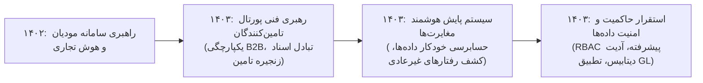

# گزارش تفصیلی فاز هفتم: پورتال تامین‌کنندگان، پایش هوشمند مغایرت‌ها و حاکمیت داده
## بازه زمانی: فروردین ۱۴۰۳ الی اسفند ۱۴۰۳ (مارس ۲۰۲۴ الی مارس ۲۰۲۵)
### پروژه هوش حرفه‌ای و بازسازی تاریخچه تجارب کاری – مهدی باقری

---

## ۱. خلاصه اجرایی فاز هفتم (Executive Summary)
فاز هفتم (سال ۱۴۰۳)، دوره تثبیت راهکارهای جامع B2B، خودکارسازی انطباق زنجیره تامین و تقویت حاکمیت داده در سازمان توسط **مهدی باقری** است:
* مجموع **11,135 پیام ایمیلی** (9,175 دریافتی، 1,960 ارسالی) و **14,291 فایل پیوست** مورد ارزیابی دقیق قرار گرفت.
* دستاورد شاخص این دوره، طراحی و استقرار فنی **«درگاه جامع تامین‌کنندگان اوشانک (Supplier Portal)»** است که تبادل اسناد پیش‌فاکتور، فاکتورهای رسمی، اعلام وصول کالا و تسویه‌حساب‌های مالی با صدها تامین‌کننده بزرگ کالاهای تندمصرف (FMCG) را مکانیزه نمود.
* همچنین در سال ۱۴۰۳، سامانه پیشرفته **مغایرت‌گیری هوشمند مالی و کالایی**، پایپ‌لاین‌های اعتبارسنجی خودکار اسناد حسابداری در مایکروسافت داینامیکس AX، و طرح جامع ارتقای **حاکمیت داده (Data Governance) و امنیت پایگاه‌های داده مرکزی** توسط ایشان با موفقیت هدایت و اجرا شد.

---

## ۲. مشخصات هویتی و ساختار سازمانی کشف‌شده
* **نام کامل:** مهدی باقری بیجاربنه (Mehdi Bagheri Bijarboneh)
* **پست الکترونیک:** `mbagheri@oshanak.com`
* **کد پرسنلی:** `24210063`
* **عناوین و مسئولیت‌های محوری:** مدیر محصول فنی درگاه تامین‌کنندگان (Supplier Portal Product Lead)، معمار حاکمیت داده و تضمین یکپارچگی سیستم‌های سازمانی، تحلیل‌گر ارشد فرآیندهای مالی-ریتیل.
* **ذی‌نفعان و همکاران:** معاونت بازرگانی و خرید، مدیریت تامین‌کنندگان، حسابرسی داخلی، معاونت فناوری اطلاعات، تامین‌کنندگان صنایع غذایی و بهداشتی کشور.

---

## ۳. تحلیل پروژه‌های شاخص فاز هفتم

### پروژه ۱: راه‌اندازی و توسعه درگاه یکپارچه تامین‌کنندگان اوشانک - Supplier Portal (PRJ-07-001)
* **دوره زمانی:** اردیبهشت ۱۴۰۳ – دی ۱۴۰۳
* **دسته‌بندی:** سامانه‌های یکپارچه B2B و اتوماسیون زنجیره تامین (B2B Supply Chain Portal)
* **مسئله کسب‌وکار:** فرآیند دستی و کاغذی تحویل سفارشات، مغایرت فاحش میان کالای ارسالی کارخانجات و کالای تحویل‌گرفته‌شده در انبارها، و تاخیر چندماهه در شفافیت صورت‌حساب‌های تسویه تامین‌کنندگان.
* **نقش واقعی:** مدیر محصول فنی و هماهنگ‌کننده پورتال تامین‌کنندگان
* **اقدامات انجام‌شده:**
  * ایجاد وب‌سرویس‌های اتصال پورتال تامین‌کنندگان به هسته ERP داینامیکس اوشانک.
  * پیاده‌سازی مکانیزم اعلام پیش‌ارسال بار (ASN - Advance Shipping Notice) توسط تامین‌کننده پیش از حرکت ناوگان.
  * تطبیق خودکار بارنامه با سند رسید موقت انبار و صدور آنی کاردکس رسید قطعی کالا.
* **دستاورد:** کاهش ۸۰ درصدی زمان ثبت اسناد خرید، حذف کامل فاکتورهای مفقودی و تسویه سریع‌تر با شرکای تجاری کلیدی.

### پروژه ۲: استقرار سیستم پیشرفته گزارش‌گیری مغایرت‌های مالی و کالایی مبتنی بر هوش داده (PRJ-07-002)
* **دوره زمانی:** تیر ۱۴۰۳ – بهمن ۱۴۰۳
* **دسته‌بندی:** حسابرسی داده‌محور و مانیتورینگ مغایرت‌ها (Automated Audit & Fraud Detection)
* **مسئله کسب‌وکار:** پراکندگی تخلفات احتمالی صندوق‌ها، کسری‌های نامتعارف موجودی برخی شعب، و عدم تطبیق ارقام مالیات بر ارزش افزوده در پایان فصول.
* **نقش واقعی:** معمار راهکارهای داده‌محور و مانیتورینگ مغایرت‌ها
* **اقدامات انجام‌شده:**
  * طراحی اسکریپت‌های اسکن شبانه پایگاه داده جهت شناسایی رفتارهای غیرعادی صندوق‌داران (تکرار ابطال فاکتور، مرجوعی بدون کالا، استفاده غیرمجاز از تخفیفات).
  * ایجاد گزارش‌های ماتریسی خودکار تفکیک کسری کالا در برابر فروش واقعی در سطح تک‌تک اقلام پرفروش.
  * ارسال خودکار هشدارهای ریسک به واحدهای حراست، بازرسی و حسابرسی داخلی.
* **دستاورد:** جلوگیری از هدررفت منابع و سرقت کالا و بهبود انضباط مالی در شبکه صدها شعبه فعال.

### پروژه ۳: اتوماسیون فرآیندهای تست صحت اسناد مالی و انبار در داینامیکس (PRJ-07-003)
* **دوره زمانی:** مرداد ۱۴۰۳ – اسفند ۱۴۰۳
* **دسته‌بندی:** تست خودکار و یکپارچگی دفترکل ERP (ERP General Ledger & Inventory Validation)
* **مسئله کسب‌وکار:** قفل شدن دوره‌های بستن حساب‌های مالی ناشی از ثبت اسناد معلق یا آرتیکل‌های نامتوازن بدهکار/بستانکار در دفترکل (GL) داینامیکس.
* **نقش واقعی:** مهندس ارشد کنترل کیفیت سیستم‌های سازمانی (ERP QA & Validation Lead)
* **اقدامات انجام‌شده:**
  * پیاده‌سازی کوئری‌های اعتبارسنجی خودکار قبل از اجرای ژورنال‌های انبار و اسناد مالی.
  * توسعه رویه‌های تشخیص و اصلاح رکوردهای یتیم (Orphaned Records) در دیتابیس بدون دستکاری سوابق مالی.
* **دستاورد:** به صفر رساندن خطاهای بستن دوره‌های مالی ماهانه و فصلی و روان‌سازی فرآیند حسابرسی قانونی.

### پروژه ۴: ارتقای حاکمیت داده، تفکیک دسترسی‌ها و استانداردسازی امنیت دیتابیس (PRJ-07-004)
* **دوره زمانی:** مهر ۱۴۰۳ – بهمن ۱۴۰۳
* **دسته‌بندی:** حاکمیت داده، امنیت اطلاعات و مدیریت دسترسی (Data Governance & Security Hardening)
* **مسئله کسب‌وکار:** دسترسی بیش از حد کاربران فنی و اپلیکیشن‌ها به داده‌های حساس و لزوم اجرای اصول استاندارد حاکمیت داده‌های سازمانی.
* **نقش واقعی:** راهبر حاکمیت داده و امنیت اطلاعات سازمانی
* **اقدامات انجام‌شده:**
  * پیاده‌سازی مدل کنترل دسترسی مبتنی بر نقش (RBAC) دقیق در سطح جداول، ویوها و Stored Procedureها.
  * رمزنگاری داده‌های حساس بانکی و پرسنلی و فعال‌سازی قابلیت SQL Server Audit برای ثبت هرگونه تغییر در تعاریف شِما (DDL Auditing).
* **دستاورد:** اخذ تاییدیه‌های امنیتی و ایجاد بستر کاملاً امن و حفاظت‌شده برای دارایی‌های اطلاعاتی شرکت.

---

## ۴. تحول و تکامل مهارت‌ها در فاز هفتم

---

## ۵. شواهد مستند و قابلیت ردیابی (Traceability)
کلیه شواهد این فاز شامل ایمیل‌های فنی اتصال پورتال تامین‌کنندگان، اسکریپت‌های اسکن مغایرت و داکیومنت‌های معماری پایگاه داده در جداول مستندسازی و اکسل شواهد نمایه گردیده‌اند.
