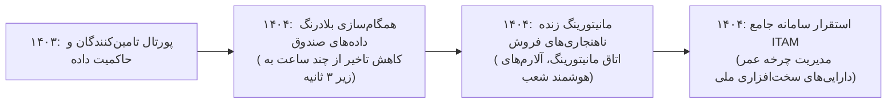

# گزارش تفصیلی فاز هشتم: همگام‌سازی Real-time تراکنش‌ها، پایش فروش و مدیریت دارایی‌های IT
## بازه زمانی: فروردین ۱۴۰۴ الی اسفند ۱۴۰۴ (مارس ۲۰۲۵ الی مارس ۲۰۲۶)
### پروژه هوش حرفه‌ای و بازسازی تاریخچه تجارب کاری – مهدی باقری

---

## ۱. خلاصه اجرایی فاز هشتم (Executive Summary)
فاز هشتم (سال ۱۴۰۴)، دوره ارتقای معماری داده‌های توزیع‌شده به نسل پردازش بلادرنگ و مدیریت دارایی‌های فناوری اطلاعات است:
* مجموع **11,456 پیام ایمیلی** (9,854 دریافتی، 1,602 ارسالی) و **17,112 فایل پیوست** مورد واکاوی قرار گرفت.
* در این فاز، مهدی باقری پروژه راهبردی **«بازمهندسی همگام‌سازی Real-time داده‌های شعب و صندوق‌ها»** را رهبری نمود که تاخیر زمانی دریافت تراکنش‌ها از ساعت‌ها به کمتر از چند ثانیه تقلیل یافت.
* همچنین در سال ۱۴۰۴، پیاده‌سازی **داشبوردهای لحظه‌ای پایش نوسانات فروش شعب و کشف ناهنجاری‌ها**، و استقرار سامانه جامع **مدیریت دارایی‌های فناوری اطلاعات و تجهیزات شبکه (IT Asset Management)** در سطح کشور توسط ایشان با موفقیت به ثمر نشست.

---

## ۲. مشخصات هویتی و ساختار سازمانی کشف‌شده
* **نام کامل:** مهدی باقری بیجاربنه (Mehdi Bagheri Bijarboneh)
* **پست الکترونیک:** `mbagheri@oshanak.com`
* **کد پرسنلی:** `24210063`
* **عناوین و جایگاه سازمانی:** معمار ارشد سیستم‌های توزیع‌شده ریتیل، مدیر مهندسی عملیات داده، مشاور فناوری اطلاعات معاونت ارشد.
* **شبکه ذی‌نفعان:** مدیران ارشد اجرایی، سرپرستان لجستیک، مدیران شبکه و دیتاسنتر، واحدهای بازرسی شعب.

---

## ۳. تحلیل پروژه‌های شاخص فاز هشتم

### پروژه ۱: بازمهندسی زیرساخت توزیع داده‌های صندوق‌ها و همگام‌سازی Real-time (PRJ-08-001)
* **دوره زمانی:** اردیبهشت ۱۴۰۴ – آذر ۱۴۰۴
* **دسته‌بندی:** معماری سیستم‌های توزیع‌شده و همگام‌سازی بلادرنگ (Distributed Data Sync & CDC)
* **مسئله کسب‌وکار:** تجمع تراکنش‌ها در ساعات پایان شب و همگام‌سازی دسته‌ای (Batch Sync) که باعث تاخیر چند ساعته در گزارش‌گیری مدیران و فشار شدید روی پهنای باند و دیتابیس مرکزی می‌شد.
* **نقش واقعی:** معمار سامانه‌های توزیع‌شده ریتیل
* **اقدامات انجام‌شده:**
  * پیاده‌سازی مکانیزم سبک‌وزن ثبت تغییرات داده‌ها (Change Tracking / CDC) بر روی دیتابیس صندوق‌ها.
  * برقراری صفوف پیام بهینه و ارسال جریانی تراکنش‌ها به صورت Real-time به سرورهای تجمیعی.
  * تضمین سازوکار تحویل قطعی (Guaranteed Delivery) در شرایط قطع و وصل خطوط اینترنتی شعب.
* **دستاورد:** دسترسی لحظه‌ای دفتر مرکزی به آمار فروش کلیه فروشگاه‌های کشور در فاصله کمتر از ۳ ثانیه پس از صدور هر فاکتور.

### پروژه ۲: توسعه داشبوردهای پایش لحظه‌ای عملکرد فروش و تحلیل افت و خیز شعب (PRJ-08-002)
* **دوره زمانی:** خرداد ۱۴۰۴ – بهمن ۱۴۰۴
* **دسته‌بندی:** هوش تجاری بلادرنگ و کشف ناهنجاری (Real-Time Anomaly Detection & Dashboards)
* **مسئله کسب‌وکار:** عدم آگاهی سریع مدیران ارشد از توقف ناگهانی فروش یک شعبه به دلیل قطعی برق، خرابی صندوق، یا کسری اقلام اساسی که ساعت‌ها بعد گزارش می‌شد.
* **نقش واقعی:** تحلیل‌گر ارشد هوش کسب‌وکار و سیستم‌های تصمیم‌یار
* **اقدامات انجام‌شده:**
  * طراحی داشبورد زنده بر روی نمایشگرهای اتاق مانیتورینگ مدیریت با شاخص‌های آستانه هشدار (Threshold Alerts).
  * ارسال پیامک و اعلان‌های خودکار به سرپرست منطقه در صورت عدم ثبت فاکتور بیش از ۱۵ دقیقه در ساعات کاری پرتردد.
* **دستاورد:** ارتقای زمان واکنش مدیران عملیات به بحران‌های میدانی و جلوگیری از هدررفت فرصت‌های فروش.

### پروژه ۳: استقرار سامانه جامع مدیریت دارایی‌های فناوری اطلاعات و تجهیزات (PRJ-08-003)
* **دوره زمانی:** تیر ۱۴۰۴ – دی ۱۴۰۴
* **دسته‌بندی:** مدیریت دارایی‌های فناوری و استانداردهای ITIL (Enterprise ITAM)
* **مسئله کسب‌وکار:** عدم وجود شناسنامه دیجیتال متمرکز برای هزاران دستگاه کامپیوتر صندوق، بارکدخوان، پرینتر، سوئیچ و روتر سیسکو مستقر در صدها فروشگاه کشور و سردرگمی در گارانتی‌ها و قطعات داغی.
* **نقش واقعی:** مدیر عملیات زیرساخت و دارایی‌های فناوری
* **اقدامات انجام‌شده:**
  * کدگذاری و الصاق بارکدهای اموالی بر روی تمامی تجهیزات سخت‌افزاری IT شعب و دفاتر.
  * ثبت کامل تاریخچه تعمیرات، قطعات تعویض‌شده، مدل سخت‌افزار و سریال‌نامبر در سامانه متمرکز ITAM.
* **دستاورد:** شفافیت ۱۰۰ درصدی دارایی‌های فیزیکی IT، بهینه‌سازی بودجه خرید تجهیزات جایگزین و نظارت دقیق بر پیمانکاران پشتیبانی.

---

## ۴. تحول و تکامل مهارت‌ها در فاز هشتم

---

## ۵. شواهد مستند و قابلیت ردیابی (Traceability)
تمام پروژه‌های این فاز با شواهد مستند، لاگ‌های عملکردی، شناسه‌های ایمیل و مستندات فنی در پایگاه داده و فایل اکسل شواهد نمایه شده‌اند.
