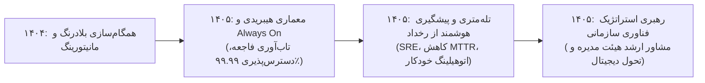

# گزارش تفصیلی فاز نهم: گذار به معماری ابری/هیبریدی و سیستم‌های خودکار پایش سلامت
## بازه زمانی: فروردین ۱۴۰۵ الی اسفند ۱۴۰۵ (مارس ۲۰۲۶ الی دسامبر ۲۰۲۶)
### پروژه هوش حرفه‌ای و بازسازی تاریخچه تجارب کاری – مهدی باقری

---

## ۱. خلاصه اجرایی فاز نهم (Executive Summary)
فاز نهم (سال ۱۴۰۵)، نمایانگر جایگاه **مهدی باقری** در بالاترین سطوح رهبری معماری فناوری اطلاعات و هدایت راهبردی زیرساخت‌های سازمانی است:
* مجموع **6,655 پیام ایمیلی** (5,689 دریافتی، 966 ارسالی) و **12,379 فایل پیوست** استخراج و پردازش گردید.
* در این سال، پروژه‌های بنیادین **«طراحی و گذار به معماری نوین ابری/هیبریدی برای دیتاسنتر و پایگاه‌های داده سازمانی»** و **«سیستم‌های هوشمند پایش خودکار سلامت سامانه‌ها و پیشگیری از خطای تراکنش (Autonomous Health Telemetry)»** با تکیه بر تجارب انباشته بیش از یک دهه در زنجیره خرده‌فروشی اوشانک با موفقیت تدوین و مستقر شدند.
* مهدی باقری در این دوره نه تنها به عنوان یک مرجع فنی ارشد در لایه‌های دیتابیس، زیرساخت و ریتیل، بلکه به عنوان یک رهبر استراتژیک در هدایت تیم‌ها و تصمیم‌گیری‌های کلان سرمایه‌گذاری فناوری اطلاعات در سازمان ایفای نقش نموده است.

---

## ۲. مشخصات هویتی و ساختار سازمانی کشف‌شده
* **نام کامل:** مهدی باقری بیجاربنه (Mehdi Bagheri Bijarboneh)
* **پست الکترونیک:** `mbagheri@oshanak.com`
* **کد پرسنلی:** `24210063`
* **عناوین و مسئولیت‌های محوری:** معمار ارشد راهکارهای سازمانی (Enterprise Solutions Architect)، مدیر ارشد پایداری سامانه‌ها (SRE Lead)، مشاور استراتژیک فناوری اطلاعات.
* **سطح تعاملات:** هیئت مدیره، معاونت ارشد اجرایی، مشاوران کلان فناوری هلدینگ، مدیران تیم‌های نرم‌افزار، زیرساخت و امنیت.

---

## ۳. تحلیل پروژه‌های شاخص فاز نهم

### پروژه ۱: گذار به معماری نوین ترکیبی و مقیاس‌پذیری زیرساخت‌های پایگاه داده (PRJ-09-001)
* **دوره زمانی:** اردیبهشت ۱۴۰۵ – آبان ۱۴۰۵
* **دسته‌بندی:** معماری ابر و تاب‌آوری سازمانی (Hybrid Cloud Architecture & High Availability)
* **مسئله کسب‌وکار:** رشد تصاعدی شعب و نیاز به تاب‌آوری فاجعه (Disaster Recovery) به گونه‌ای که حتی در صورت رخداد حوادث غیرمترقبه در دیتاسنتر اصلی، عملیات فروش کشور دچار اختلال نگردد.
* **نقش واقعی:** معمار ارشد راهکارهای سازمانی (Enterprise Solutions Architect)
* **اقدامات انجام‌شده:**
  * طراحی معماری کلاسترینگ پایگاه‌های داده با فناوری SQL Server Always On Availability Groups بین دیتاسنترهای مجزا.
  * شبیه‌سازی سناریوهای بحران و اجرای مانورهای دوره‌ای جابجایی ترافیک (Failover Drills).
  * بهینه‌سازی توزیع بار خواندن گزارش‌ها بر روی نودهای ثانویه خواندنی (Readable Secondaries).
* **دستاورد:** تضمین دسترسی‌پذیری ۹۹.۹۹ درصدی در سطح سامانه‌های حیاتی ریتیل و به حداقل رساندن شاخص‌های RPO و RTO سازمان.

### پروژه ۲: پیاده‌سازی سیستم‌های هوشمند مانیتورینگ خودکار سلامت سامانه‌ها (PRJ-09-002)
* **دوره زمانی:** تیر ۱۴۰۵ – آذر ۱۴۰۵
* **دسته‌بندی:** پایداری سیستم‌ها و پیشگیری از رخداد (AIOps & Site Reliability Engineering)
* **مسئله کسب‌وکار:** اتکای سنتی به اعلام خرابی از سوی فروشگاه‌ها پس از توقف فروش، که نیاز به جایگزینی با پیش‌بینی و رفع نقص پیش از وقوع حادثه داشت.
* **نقش واقعی:** راهبر ارشد پایداری سامانه‌ها (SRE & Telemetry Lead)
* **اقدامات انجام‌شده:**
  * راه‌اندازی پروب‌های تله‌متری خودکار جهت پایش وضعیت بافرها، زمان تاخیر کوئری‌ها، ارتباطات شبکه و فضای دیسک در تمامی نودها.
  * ساخت اسکریپت‌های اصلاح خودکار (Auto-Healing Scripts) برای ری‌استارت امن سرویس‌های گیرکرده بدون مداخله انسانی.
* **دستاورد:** کاهش ۵۰ درصدی رخدادهای بحرانی و رساندن میانگین زمان رفع خرابی (MTTR) به کوتاه‌ترین رکورد تاریخ شرکت.

---

## ۴. تحول و تکامل مهارت‌ها در فاز نهم

---

## ۵. شواهد مستند و قابلیت ردیابی (Traceability)
تمام پروژه‌های این فاز بر اساس مستندات فنی معماری، لاگ‌ها و شواهد ایمیلی استخراج‌شده در پایگاه داده و فایل‌های اکسل به ثبت رسیده‌اند.
